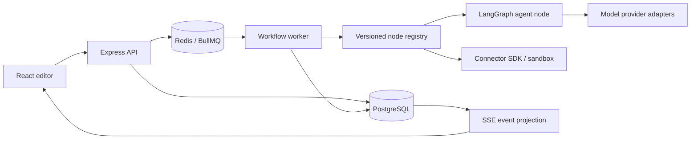
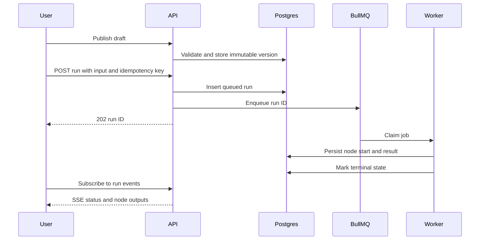
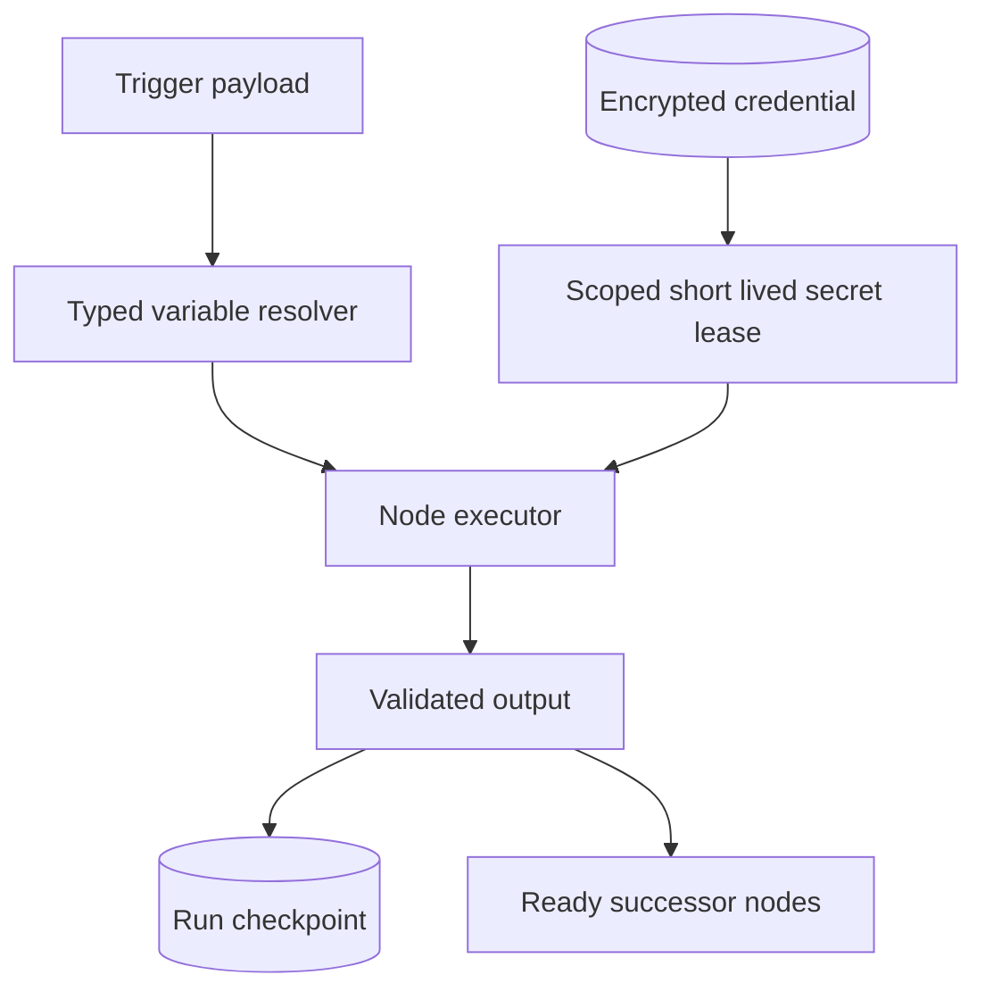

# AI Workflow Builder: product and implementation blueprint

Status: original architecture baseline, 24 October 2026. This document is the long-term design; see [current gap audit](GAP_AUDIT.md) for implemented capabilities and the revised delivery order.

## Product brief

**Audience:** technical operations teams and developers who need auditable automations that combine ordinary API actions with AI decisions. **Job:** build, test, publish, and operate a workflow without hiding the state that led to an external side effect.

**Differentiation hypothesis:** make every workflow version reproducible; expose typed node contracts, node level traces, provider choice, approval boundaries, and recovery decisions in one interface. This is a product direction rather than a claim that competitors lack these features. Validate it with 8–12 user interviews and task based usability studies before widening the catalog.

**Success criteria for MVP:** a new user can create and publish a three-node manual workflow in under five minutes; 99% of accepted runs reach a terminal state under a controlled single-node failure test; every completed node has inspectable input/output metadata; a restart does not lose a queued run. Define performance SLOs after load measurement rather than guessing a production throughput.

**Non-goals for initial MVP:** arbitrary JavaScript execution, unrestricted graph cycles, a broad connector marketplace, multi-agent orchestration, and paid hosted inference. The example Gmail → classifier → RAG → agent → approval → Jira → Slack is the target integration test for later phases, not a Phase 1 feature.

## Market research and UX lessons

| Platform | Evidence-backed strengths | Design lesson and trade-off |
| --- | --- | --- |
| n8n | Its [queue mode](https://docs.n8n.io/hosting/scaling/queue-mode/) separates main instances from workers with Redis. | Queue workers separately; keep version and execution metadata in Postgres. |
| Dify | [Workflow Studio](https://www.dify.ai/workflows) brings model calls, retrieval, branching, triggers, human review, testing, and traces into one canvas. | Keep AI and automation debug views together; avoid making the AI framework the only runtime. |
| Flowise | [Agentflow V2](https://docs.flowiseai.com/using-flowise/agentflowv2) exposes standalone nodes, state, and human input. | Define versioned node schemas and separate agent state from workflow state. |
| Zapier | [Paths](https://help.zapier.com/hc/en-us/articles/8496288555917-Add-branching-logic-to-Zap-workflows-with-Paths) and [run history](https://help.zapier.com/hc/en-us/articles/8496291148685-View-and-manage-your-Zap-history) make branching and replay discoverable. | Put run history next to the editor and show the exact published version. |
| Activepieces | Its [architecture](https://www.activepieces.com/docs/install/architecture/overview) uses Postgres, Redis/BullMQ, workers, sandboxed execution, and typed pieces. | Use similar separation for scale; add a sandbox before accepting third-party code. |

**Research caveat:** public docs describe current product capabilities, not independent reliability measurements. Validate UX claims with actual users and a current competitive walkthrough before committing to positioning.

## Architecture decisions

1. **Modular monolith plus worker.** Express owns validation and persistence; BullMQ workers own execution. One deployable API and one worker binary initially. This keeps local operation simple while allowing independent worker scale.
2. **Postgres is authoritative.** Workflow versions, run state, and node attempts live in Postgres. Redis is transport and scheduling, not the only record of business state. A reconciliation loop will eventually re-enqueue stuck queued runs.
3. **Immutable published graphs.** Drafts are mutable. Publishing validates and snapshots the graph; runs reference a version ID. Schema migration must preserve the executor version used by an in-flight run.
4. **Typed registry.** Node definitions declare configuration, input/output types, capabilities, and schema versions. Executable implementations register by type/version. The browser renders forms from public metadata; secrets never enter the graph JSON.
5. **General workflow engine owns automation.** It resolves dependencies, branch decisions, retries, waits, approvals, and side effects. LangGraph is invoked *inside* an agent node for model/tool reasoning and checkpointed agent state. The workflow engine does not delegate its entire DAG to LangGraph. [LangGraph persistence](https://langchain-ai.github.io/langgraphjs/how-tos/persistence-postgres/) supports agent resumption, but external effects still need idempotency.
6. **Bounded semantics.** Published top-level graphs are DAGs. A loop is an explicit container with iteration and wall-clock limits; a subworkflow is version-pinned and has depth limits.
7. **Security boundary.** The first public release requires identity, workspace scoped queries, encrypted credentials, network egress controls, and isolated connector execution before untrusted users or community code are allowed. Phase 1 is local development only.

## System views







## Target repository structure

```text
apps/web              React, Vite, React Flow, Zustand, TanStack Query
apps/api              Express routes, auth, versioning, SSE
apps/worker           BullMQ worker and recovery
packages/contracts    Zod schemas, node metadata, API contracts
packages/db           Prisma schema and migrations
packages/engine       DAG planner, executor registry, scheduler
packages/providers    model discovery, adapters, fallback, usage
packages/connectors   connector SDK and built-in connectors
packages/ui           shadcn/ui components and shared design tokens
docs                  PRD, architecture decisions, operations
```

The first six paths and `packages/security` exist today. Provider, connector, and shared UI packages are phase milestones. Phase 1 uses Tailwind styled local UI components; moving them to a generated shadcn/ui package is scheduled for Phase 2.

## Database design

Phase 1 tables: `Workflow(id, name, draft, version)`, `WorkflowVersion(workflowId, number, graph)`, `Run(workflowId, versionId, status, input, output, error, timestamps)`, and `RunStep(runId, nodeId, kind, status, input, output, error, timestamps)`. `(workflowId, number)` and `(runId, nodeId)` are unique. A run always points at its immutable graph snapshot.

Production evolution: `User`, `Workspace`, `Membership(role)`, `Credential(workspaceId, encryptedPayload, keyVersion)`, `Connection`, `TriggerSubscription`, `Schedule`, `Approval`, `AuditEvent`, `RunEvent(sequence)`, `NodeAttempt(attempt)`, `UsageEvent`, `Document`, and `Embedding`. Every tenant-owned record carries `workspaceId`; every query scopes by it. pgvector indexes `Embedding.vector`, with collection and workspace filters before similarity search. Store large payloads in an object store with redacted DB metadata; set retention per workspace.

## API contract

Phase 1: `GET /health`; `GET /api/nodes`; `GET/POST /api/workflows`; `GET /api/workflows/:id`; `PUT /api/workflows/:id/draft`; `POST /api/workflows/:id/publish`; `POST/GET /api/workflows/:id/runs`; `GET /api/runs/:id`; `GET /api/runs/:id/events` (SSE). Requests and graphs are Zod validated. `POST runs` returns `202` and a run ID; publish returns the immutable version.

Production additions: `POST /auth/login`, `GET /me`, workspace CRUD, credential CRUD with write-only secret fields, `GET /providers/:id/models`, trigger registration, signed webhook ingestion, `POST /runs/:id/cancel`, `POST /approvals/:id/decision`, `POST /runs/:id/replay`, run event pagination, and template import/export. Use a consistent JSON error envelope with `code`, `message`, `requestId`, and field details. Require `Idempotency-Key` for external trigger ingestion and action retry APIs. Apply cursor pagination to list endpoints.

## Extension contracts

```ts
interface NodeDefinition<Config, Input, Output> {
  type: string; version: number;
  configSchema: ZodSchema<Config>;
  inputSchema: ZodSchema<Input>; outputSchema: ZodSchema<Output>;
  capabilities: Array<'network'|'secrets'|'model'|'human-wait'>;
  execute(ctx: ExecutionContext, config: Config, input: Input): Promise<Output>;
}
interface Connector {
  id: string; version: string;
  auth: OAuth2Definition | ApiKeyDefinition;
  actions: Record<string, NodeDefinition<unknown, unknown, unknown>>;
  triggers: Record<string, TriggerDefinition>;
}
interface ModelProvider {
  id: string;
  discoverModels(ctx: ProviderContext): Promise<ModelDescriptor[]>;
  invoke(request: ModelRequest, signal: AbortSignal): Promise<ModelResult>;
}
```

The registry resolves an exact `(type, version)` at publish and run time. Dynamic forms derive from safe public metadata, with explicit secret selectors. Connector authentication is a scoped capability and token refresh is serialized per credential to avoid refresh races. Provider fallback only crosses models with compatible modality, context length, tool/JSON support, and data policy; retries respect `Retry-After` and a per-provider budget. Token and cost accounting uses provider-reported usage where available and labels estimates otherwise.

## Model availability for key-free development

**Default:** deterministic mock provider for tests, plus optional [Ollama local API](https://docs.ollama.com/api/introduction) for real local inference. No paid key is required. [OpenRouter's free plan](https://openrouter.ai/pricing) currently advertises 50 requests/day and free models; it is for prototyping, with availability varying by model. [Gemini free tier](https://ai.google.dev/gemini-api/docs/pricing) grants limited model access; [per-project limits vary](https://ai.google.dev/gemini-api/docs/rate-limits) and must be read in AI Studio. [Groq limits](https://console.groq.com/docs/rate-limits) are model/account specific and exposed in response headers; its published table is not a promise of every account's free quota. Provider adapters will discover model catalogs at runtime and never hardcode a free model as guaranteed.

## Milestones and acceptance gates

| Phase | Scope | Acceptance and tests | Commands |
| --- | --- | --- | --- |
| 1: vertical slice | Manual trigger, text/uppercase actions, editor, draft/publish, queue worker, run history and live status | Three-node workflow publishes and returns expected output; invalid/disconnected graph is rejected; unit and type checks pass | `yarn install`, `docker compose up -d`, `yarn db:generate`, `yarn db:migrate`, `yarn dev`, `yarn test`, `yarn typecheck` |
| 2: trusted MVP | Auth/RBAC, workspace isolation, shadcn/ui, HTTP action with SSRF protection, webhook trigger, typed variables, input/output validation | Cross-workspace access denied; signed webhook deduped; SSRF vectors blocked; Playwright editor E2E | `yarn test`, `yarn test:e2e`, `yarn build` |
| 3: durable engine | Dependency planner, branches/merge, parallelism, persisted node attempts, retries, cancellation, reconciler, DLQ, approval pause/resume | Kill worker mid-run; resume without repeating committed node; duplicate enqueue and race tests; approval survives restart | `yarn test:integration`, `yarn test:recovery` |
| 4: AI and retrieval | Model registry/adapters, mock/Ollama and optional free remote providers, LangGraph agent node, pgvector RAG, token usage | Local-only AI flow passes; provider fallback and rate limit tests; retrieved documents remain workspace scoped | `yarn test:integration`, `yarn test:e2e` |
| 5: connectors and operations | Gmail, Slack, GitHub, Jira, Sheets; OAuth refresh; schedules, templates, import/export, observability | Connector contract tests, OAuth refresh race tests, signed event tests, load and failure drills | `yarn test:connectors`, `yarn test:load` |

Dependent order matters: external actions follow identity, secret storage, and SSRF controls; agent and RAG nodes follow durable checkpoints; broad connectors follow the SDK and auth contract.

## Failure behaviors

| Scenario | Expected behavior |
| --- | --- |
| Invalid graph or missing executor | Reject publish with node-specific validation; do not enqueue. |
| Redis down at run submission | Persist failed enqueue state and return an error; production reconciler can safely requeue accepted queued records. |
| Worker crash after a pure node | BullMQ retries; committed successful node results are reused. For side effects, send stable action idempotency keys and reconcile ambiguous outcomes. |
| Provider 429 | Respect `Retry-After`, bounded exponential backoff, and compatible fallback; record each attempt and final reason. |
| Approval waits or times out | Persist waiting status and deadline; release worker slot; only one atomic decision wins; schedule timeout/escalation job. |
| Branch skips a path | Mark descendants skipped when no active dependency remains; merge waits for all active incoming branches, not skipped ones. |
| Cancellation race | Abort in-flight requests where possible; mark cancellation requested; do not claim a remote side effect was reversed. |
| Duplicate webhook | Unique `(workspace, trigger, deliveryId)` dedupes before enqueue. |
| Secret leaked in node output | Redact at source and at log persistence, encrypt raw diagnostic payloads if retained, and audit access. |
| Private IP/metadata URL in HTTP node | Resolve and validate all DNS answers, redirects, and final socket target; block private/link-local ranges and unsafe schemes. |

## Security and deployment baseline

Use HTTP-only secure cookies or short-lived bearer tokens with rotation, workspace scoped RBAC, audited privilege changes, envelope encryption for credentials, KMS-backed master keys in production, webhook HMAC verification with replay windows, egress allowlists, content-size limits, and isolated connector execution with CPU/memory/time budgets. Never evaluate user expressions with `eval`; parse a restricted expression grammar and bind only declared upstream outputs. Mask secrets in run output and events.

Local development runs PostgreSQL with pgvector and Redis in Docker Compose, with web/API/worker on the host. CI builds, type checks, tests, and validates migrations against a disposable Postgres. Production uses managed PostgreSQL/Redis, separate API and worker replicas, TLS ingress, database backups/PITR, a queue lag alert, run-state reconciliation, OpenTelemetry traces, and metrics for enqueue latency, worker lag, node duration/error rate, and provider usage. Scale workers by queue lag and concurrency budgets; partition run events and archive old payloads before database growth becomes a bottleneck.

## Current implementation

The original Phase 1 slice has expanded to include authentication/RBAC, workspace isolation, conditions, scheduled and signed webhook triggers, encrypted connections, HTTP/Slack/GitHub actions, and approval pause/resume. SSE projects database state at one-second intervals. See [current gap audit](GAP_AUDIT.md) for exact shipped scope, limitations, and next gates.
